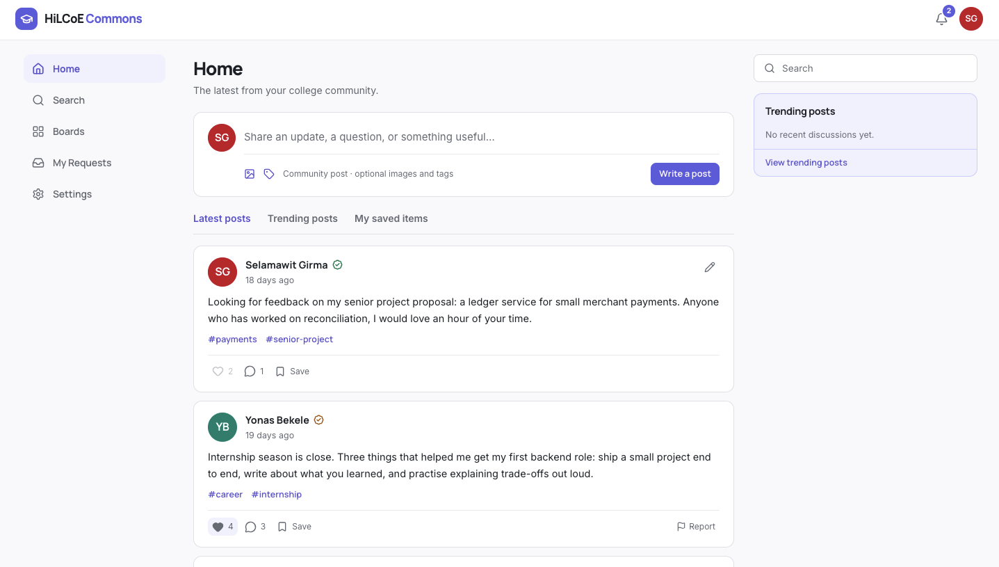
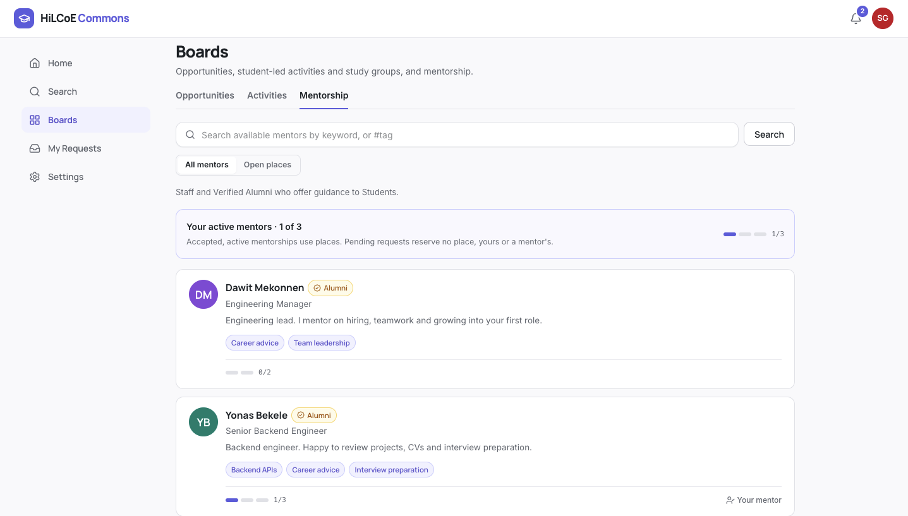
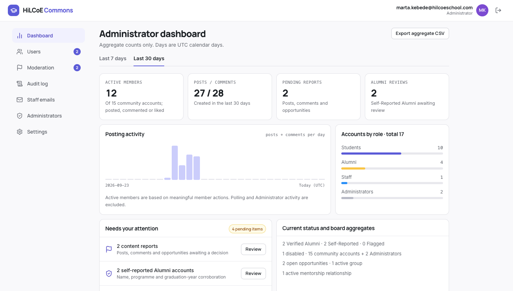

# HiLCoE Commons

**Academic Community and Alumni Engagement and Mentorship Platform for HiLCoE College.** Senior
project, BSc Computer Science, HiLCoE School of Computer Science and Technology, 2026.

HiLCoE Commons gives the College's Students, Alumni and Staff one trusted web space for community
discussion, mentorship, job and internship opportunities and student groups. Every member is tied to
a verified college mailbox or, for Alumni, reviewed by an Administrator. It complements the LMS and
the College's existing announcement channels rather than replacing them.

**Live demo:** <https://college-community-app.vercel.app>. The site runs on free hosting, so the
first page can take up to a minute to load while the server wakes up. Demonstration accounts are
available from the team on request.

## Screenshots

| Home feed | Mentorship Board | Administrator dashboard |
|---|---|---|
|  |  |  |

## Features

- **Verified membership:** registration with 6-digit email codes. Staff are recognised from an
  Administrator-maintained Staff email list; Alumni are reviewed by an Administrator before they
  are verified.
- **Posts and discussion:** posts with up to four images (with alt text) and tags, comments with
  replies, likes, view counts and a trending list.
- **Mentorship:** Staff and Verified Alumni mentors with capacity limits; contacts are shared only
  within an accepted mentorship.
- **Opportunities:** internship and job listings posted by Staff and Verified Alumni.
- **Groups and activities:** Student-owned groups with join approval, member-only coordination
  details and ownership transfer.
- **Boards and search:** Opportunities, Activities and Mentorship boards, global full-text search
  and private saved items.
- **Notifications** of activity that concerns each member.
- **Moderation:** reporting against the Community Guidelines, Administrator decisions with
  escalating consequences, and an append-only audit log.
- **Administrator tools:** Alumni and graduation review, role and email correction, account
  disable/restore, analytics dashboard and an aggregate-only CSV export. Administrators sign in
  with an authenticator app.

## Architecture

A React single-page app (served by Vercel) talks to one Express API (on Render) through a `/api`
rewrite, so the browser sees a single origin. The API is a modular monolith with one module per
functional area. Supabase provides PostgreSQL, authentication (email codes, sessions, TOTP) and
private image storage. Full details are in the design documents below.

**Stack:** React + TypeScript + Vite (client), Node.js + Express + TypeScript (server),
Prisma, Supabase (PostgreSQL, Auth, Storage), deployed on Vercel and Render.

## Quality

- About 500 automated tests:
  - Vitest unit and integration tests against a real PostgreSQL database;
  - client component tests;
  - Playwright end-to-end tests with axe WCAG 2.1 AA accessibility scans.
- CI runs formatting, linting, type checks, a schema drift check, all tests and the build on every
  push.
- **Performance (NFR-4):** with 10 concurrent users on the deployment, 99.4% of warm page loads were
  usable within 3 seconds (median 1.2 s).

## Repository layout

| Path | Contents |
|---|---|
| `shared/` | `@hilcoe/shared` (shared.contracts): Zod schemas, Input/View types, enums, error codes |
| `server/` | Express API. `src/kernel`, `src/infrastructure`, later the domain packages of ODD Table 3; `prisma/` schema and migrations; `scripts/seed.ts` |
| `client/` | React app. `src/app` (client.app), `src/auth`, `src/features`, `src/admin`, `src/api`, `src/design` (UI kit) |
| `e2e/` | Playwright use-case tests |

## Getting started

Requirements: Node 24 (`.nvmrc`), npm 11 and a Supabase project.

1. `npm install` (approve install scripts with `npm approve-scripts` if npm asks).
2. Copy `server/.env.example` to `server/.env` and `client/.env.example` to `client/.env`, then fill
   them in from the Supabase dashboard. The app tables live in the `app` schema (`?schema=app`);
   integration tests use a separate schema (`?schema=app_test`). Use the session pooler (port 5432).
3. In the Supabase dashboard (Authentication): minimum password length 15, email OTP length 6 with
   a 3600 s expiry, TOTP MFA enabled, site URL `http://localhost:5173`.
4. `npm run db:migrate` then `npm run db:seed` (ten demo identities; all use `SEED_PASSWORD`).
5. `npm run dev:server` (port 4000) and `npm run dev:client` (port 5173, proxies `/api`).

Member sign-in is at `/login`, Administrator sign-in at `/admin/login`. An Administrator without
an authenticator enrolls one at first sign-in.

## Checks

| Command | What it runs |
|---|---|
| `npm run lint` | ESLint, including the package dependency rules of ODD Tables 3 and 4 |
| `npm run format:check` | Prettier |
| `npm run typecheck` | `tsc` for every workspace and the e2e tests |
| `npm test` | Vitest: shared, server (unit + integration against `TEST_DATABASE_URL`) and client |
| `npm run e2e` | Playwright against the dev servers and the Supabase project (run the seed first; on macOS it uses installed Google Chrome) |
| `npm run ci` | format check, lint, typecheck, tests and build (what `.github/workflows/ci.yml` runs, with a Postgres service) |
| `npm run db:drift -w server` | Fails if the Prisma schema and the database differ |
| `npm run e2e:load` | NFR-4 load check: 10 concurrent members against production builds, or a deployment with `LOAD_BASE_URL` |
| `npm run cleanup -w server` | One CleanupJob run (retention sweeps and storage reconciliation); the server also runs it daily |
| `npm run db:reseed -w server` | Demonstration environment only (`DEMO_ENVIRONMENT=true`): erase all data and seed again |

## Deployment

Vercel (client, `vercel.json`), Render (server, `render.yaml`) and Supabase. 
